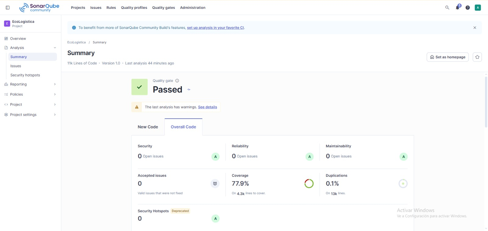

# Evaluación de Calidad de Código — SonarQube

**Nombre del Proyecto:** EcoLogística Lima – Optimizador de Rutas Sostenibles para DistriRápido S.A.C.

**Fecha de Análisis:** 2026-10-30

**Versión del Análisis:** V_1_0_0

**Herramienta:** SonarQube Community Build, proyecto `EcoLogistica`, versión 1.0, con la configuración `sonar-project.properties` (fuentes de backend y frontend, pruebas y rutas de cobertura). En la captura no se ven la rama ni el commit analizados.

## 1. Resumen Ejecutivo de Quality Gate

- **Estado del Quality Gate:** PASSED. El último análisis tiene advertencias («The last analysis has warnings»); su detalle debe registrarse.
- **Porcentaje de Cobertura de Pruebas (Coverage):** 77,9 % sobre 4,3 mil líneas por cubrir. Queda por debajo del 80 % que exige la Definition of Done. Ese análisis es anterior a las pruebas incorporadas el 30/10: la medición local posterior da backend 97 % y frontend 95,9 % de sentencias (90,2 % de ramas).
- **Duplicación de Código:** 0,1 % sobre 13 mil líneas.

## 2. Métricas Principales

| Categoría | Cantidad Detectada | Severidad (Bloqueante / Alta / Media / Baja) |
|---|---|---|
| Bugs | 0 (calificación de fiabilidad A) | Sin incidencias |
| Vulnerabilidades | 0 (calificación de seguridad A) | Sin incidencias |
| Code Smells | 0 (calificación de mantenibilidad A) | Sin incidencias |
| Security Hotspots | 0 (calificación A) | Sin hotspots |

El proyecto tiene 11 mil líneas de código (13 mil líneas en total) y 0 incidencias aceptadas (*Accepted issues*).

## 3. Plan de Remediación y Deuda Técnica

- **Deuda Técnica Estimada:** 0 min según el análisis (sin incidencias de mantenibilidad); el valor exacto de la medida *Technical Debt* se registra de *Measures*.
- **Principales hallazgos y acciones correctivas:**
  1. **Cobertura de 77,9 % en SonarQube, inferior al 80 % de la DoD.** La medición local posterior (backend 97 %, frontend 95,9 %) ya supera el umbral. Acción: volver a ejecutar SonarQube enviando los informes `coverage.xml` y `lcov.info` para actualizar el valor.
  2. **Advertencias del análisis.** Acción: abrir *See details*, registrar cada advertencia y su tratamiento.
  3. **Dependencias de desarrollo con vulnerabilidades altas** (`npm audit`, 30/10/2026): `vite` 8.3.0–8.3.2 y `undici` 8.0.0–8.12.1 (transitiva); `pip-audit` sin hallazgos. Acción: `npm audit fix` y repetir las pruebas.
  4. **Tres archivos de backend vacíos** (`generate_routes.py`, `reoptimize_route.py` y `route.py`); la lógica de planificación está en `domain/planning.py`. Acción: eliminarlos o implementarlos con la aprobación y el despacho de rutas.
  5. **Sin integración continua.** Acción: ejecutar el análisis de SonarQube y las pruebas con cobertura en cada Pull Request, con el Quality Gate como requisito de merge.

## Control de versiones del documento

| Versión | Fecha | Autoría / cambio |
|---|---|---|
| V_1_0_0 | 30/10/2026 | Tovar Sánchez, Carlos Alberto. Emisión inicial con la plantilla oficial y los resultados de SonarQube Community Build. |

[← Volver al índice correspondiente](README.md)
