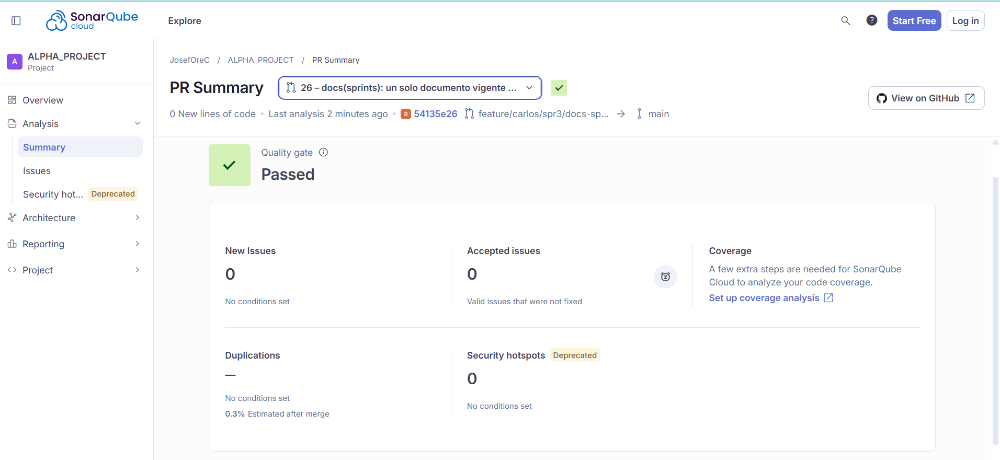

# Evaluación de Calidad de Código — SonarQube

**Nombre del Proyecto:** EcoLogística Lima – Optimizador de Rutas Sostenibles para DistriRápido S.A.C.

**Fecha de Análisis:** 2026-10-30

**Versión del Análisis:** V_1_0_0

**Versión del documento:** V_1_0_0

**Commit evaluado (mediciones locales):** `main`, `29ca820` (30/10/2026).

> **Alcance real del análisis.** El equipo ejecutó SonarQube Community Build y compartió capturas; la configuración del escaneo (`sonar-project.properties`, clave `ecologistica`, con las fuentes de backend y frontend, las pruebas y las rutas de cobertura `src/backend/coverage.xml` y `src/frontend/coverage/lcov.info`) y la cobertura de Vitest (proveedor V8, `lcov`) están en la rama de Alex (`feature/alex/spr1/m_conductor/crud`), aún sin integrar a `main`. Los resultados de SonarQube (Quality Gate, duplicación, bugs, code smells y Security Hotspots) **no están en el repositorio y no pude leerlos**: sus campos figuran «Por incorporar» hasta registrar las capturas, y no se estiman. Lo que sí medí el 30/10 con herramientas locales (cobertura, lint, tipos, auditoría de dependencias) se registra con su comando y su resultado. No existe integración continua (`.github/`).

## 1. Resumen Ejecutivo de Quality Gate

- **Estado del Quality Gate:** PASSED en SonarQube Cloud para el análisis del Pull Request #26 (commit `54135e26`, 30/10/2026). Ese análisis cubre **0 líneas nuevas de código** (el PR solo contiene documentación), de modo que el resultado no evalúa el código existente del proyecto; el Quality Gate del análisis completo de `main` está por incorporar.
- **Porcentaje de Cobertura de Pruebas (Coverage):** backend **82 %** de sentencias (`pytest-cov` sobre `application`, `domain`, `infrastructure` e `interfaces`; 225 pruebas aprobadas) y frontend **80,0 %** de sentencias, 72,5 % de ramas, 80,6 % de funciones y 85,8 % de líneas (`vitest --coverage`, proveedor V8; 273 pruebas aprobadas). Es cobertura global del código, no del código nuevo del sprint, y proviene de herramientas locales, no de SonarQube.
- **Duplicación de Código:** **0,3 %** estimada tras el merge (SonarQube Cloud, PR #26; sin condiciones definidas en el Quality Gate). Es la estimación del análisis del PR; la duplicación medida sobre `main` está por incorporar.

Otros indicadores locales (30/10/2026): `oxlint` sin advertencias, `tsc -b` sin errores, compilación de producción completada; backend con 225 pruebas aprobadas, 5 omitidas (integración con PostgreSQL real) y 36 subpruebas.

## 2. Métricas Principales

| Categoría | Cantidad Detectada | Severidad (Bloqueante / Alta / Media / Baja) |
|---|---|---|
| Bugs | Por incorporar de SonarQube | Pendiente |
| Vulnerabilidades | **0** nuevas en el PR #26 (0 líneas nuevas); total sobre `main` por incorporar. Auditoría de dependencias: `npm audit` 2 altas, `pip-audit` 0 (ver sección 3) | Alta (dependencias de desarrollo) |
| Code Smells | **0** nuevos en el PR #26 (0 líneas nuevas); total sobre `main` por incorporar. Observación manual: 3 archivos de backend vacíos (`generate_routes.py`, `reoptimize_route.py`, `route.py`) | Pendiente |
| Security Hotspots | **0** en el análisis del PR #26 (0 líneas nuevas; no evalúa el código existente). Candidatos por inspección manual en el documento [04 OWASP](04%20OWASP%20V_1_1_0.md) | Sin severidad reportada por SonarQube |

## 3. Plan de Remediación y Deuda Técnica

- **Deuda Técnica Estimada:** por incorporar de SonarQube (la calcula a partir de sus hallazgos).
- **Principales hallazgos y acciones correctivas:**
  1. **Vite 8.3.0 – 8.3.2 con vulnerabilidad alta** (dependencia directa de desarrollo; `launch-editor` con escape incompleto de argumentos en Windows). Corrección disponible: actualizar `vite` a una versión posterior a 8.3.2 con `npm audit fix` y volver a correr las pruebas. **No aplicada** en esta fecha.
  2. **`undici` 8.0.0 – 8.12.1 con vulnerabilidad alta** (transitiva; denegación de servicio por memoria no acotada en el analizador de `EventSource`). Se corrige junto con el punto anterior. **No aplicada.**
  3. **Cobertura de ramas del frontend en 72,5 %** y sentencias en 80,0 %, justo en el umbral de la Definition of Done (≥ 80 % del código nuevo). Acción: agregar pruebas a las ramas de error de los adaptadores HTTP y a las vistas de administración; medir la cobertura por archivo modificado en cada Pull Request.
  4. **Tres archivos de backend vacíos** (`generate_routes.py`, `reoptimize_route.py` y `route.py`) y duplicidad entre el módulo de planificación estimada y el caso de uso previsto. Acción: eliminarlos o implementarlos al construir el motor de rutas (EN-01).
  5. **Análisis estático sin integración continua.** La configuración de SonarQube existe en la rama de Alex. Acción: integrarla a `main` mediante Pull Request, generar la cobertura de backend con `pytest --cov --cov-report=xml` (archivo `src/backend/coverage.xml`) y la de frontend con `vitest --coverage` (`lcov`), y agregar un flujo de CI que ejecute el escaneo con el Quality Gate como requisito de merge.

**Para completar este documento:** agregar las capturas del análisis de la rama `main` en SonarQube Cloud: (1) *Overview* con el Quality Gate, Security, Reliability, Maintainability, Hotspots revisados, cobertura, duplicación y líneas de código; (2) *Issues* con el conteo por tipo (bugs, vulnerabilidades y code smells) y severidad; (3) *Security Hotspots* con su lista y estado; (4) *Measures* con la deuda técnica; y registrar la fecha y el commit analizados.

**Comandos usados en esta evaluación (desde `src/backend` y `src/frontend`):**

```powershell
# Backend
.venv\Scripts\python.exe -m pytest -q --cov=application --cov=domain --cov=infrastructure --cov=interfaces --cov-report=term
.venv\Scripts\python.exe -m pip_audit -r requirements.txt
# Frontend
npx vitest run --coverage --coverage.reporter=text-summary
npx oxlint ; npx tsc -b ; npm audit
```

## Evidencia de SonarQube Cloud

Captura del resumen del Pull Request #26 en SonarQube Cloud (proyecto `JosefOreC / ALPHA_PROJECT`, rama `feature/carlos/spr3/docs-sprints` hacia `main`, análisis del commit `54135e26`, 30/10/2026):



| Indicador | Valor en la captura |
|---|---|
| Quality Gate | Passed |
| Líneas nuevas de código | 0 |
| New Issues / Accepted Issues | 0 / 0 |
| Security Hotspots | 0 |
| Duplicaciones en código nuevo | Sin dato; **0,3 %** estimado tras el merge |
| Cobertura | No configurada en SonarQube Cloud («A few extra steps are needed to analyze your code coverage») |

**Límites de esta evidencia.** Es un análisis de Pull Request con cero líneas nuevas, así que no sustituye al análisis del código completo. La cobertura no llega a SonarQube todavía: los informes `coverage.xml` y `lcov.info` que configura `sonar-project.properties` no se envían, por lo que las cifras de cobertura de este documento son las medidas localmente. Para completar el documento se necesitan las pantallas del análisis de la rama `main` (ver «Para completar este documento»).

## Control de versiones del documento

| Versión | Fecha | Autoría / cambio |
|---|---|---|
| V_1_0_0 | 30/10/2026 | Tovar Sánchez, Carlos Alberto. Emisión inicial con la plantilla oficial: cobertura, lint y auditoría de dependencias medidos localmente y resumen de SonarQube Cloud del PR #26; análisis de `main` por incorporar. |

[← Volver al índice correspondiente](README.md)
