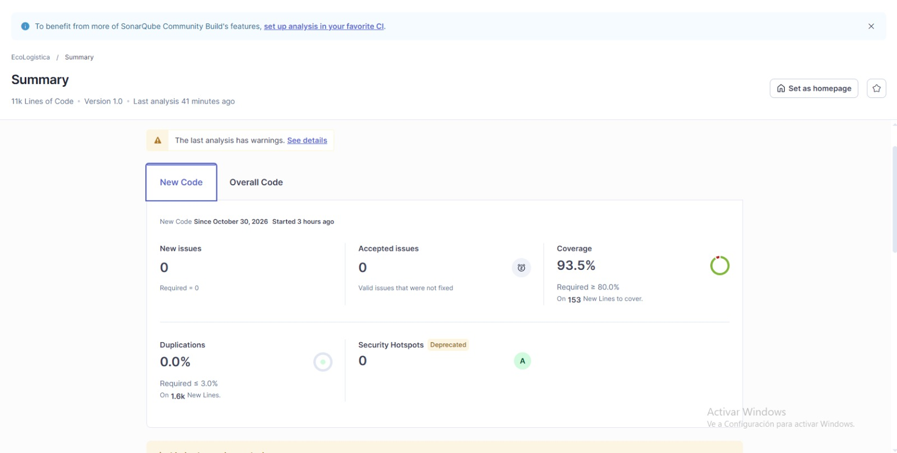

# Evaluación de Calidad de Código — SonarQube

**Nombre del Proyecto:** EcoLogística Lima – Optimizador de Rutas Sostenibles para DistriRápido S.A.C.

**Fecha de Análisis:** 30/10/2026

**Versión del documento:** V_1_1_0

**Herramienta:** SonarQube Community Build, proyecto `EcoLogistica`, versión 1.0. Es el análisis de referencia de este documento y sus capturas están en `evidencias-sonar/`. El repositorio mantiene además la configuración de **SonarCloud** para el flujo de integración continua (`.github/workflows/sonarcloud.yml`, proyecto `JosefOreC_ALPHA_PROJECT`): son dos ejecuciones distintas y este documento describe la de Community Build. En la captura no se ven la rama ni el registro de cambio analizados.

## 1. Resumen ejecutivo del control de calidad

- **Estado del control de calidad:** aprobado en SonarQube Community Build. Sus condiciones para el código nuevo o modificado desde el 30/10/2026 son 0 incidencias nuevas, cobertura ≥ 80 % y duplicación ≤ 3 %. El flujo de integración continua es una comprobación distinta: su umbral para Python exige al menos 90 % tanto en líneas como en ramas. El último análisis de Community Build registra dos advertencias: `sonar.python.version` sin definir (ya se fijó en 3.14 en `sonar-project.properties`; surtirá efecto en el siguiente análisis) y falta la información de autoría de los archivos en Git de 196 archivos.
- **Cobertura de SonarQube Community Build:** **80,4 % del código completo** y **93,5 % del código nuevo o modificado**. El 93,5 % se calcula sobre 153 líneas nuevas a cubrir y se compara con el mínimo del 80 % establecido por el control de calidad y la definición de terminado; el 80,4 % corresponde al código completo y no al código nuevo. SonarQube define esta métrica combinando líneas y condiciones cubiertas. Las líneas a cubrir excluyen comentarios, líneas en blanco y código no ejecutable; el denominador del código completo es de aproximadamente 4,3 mil líneas a cubrir.
- **Cobertura local de pruebas:** la ejecución registrada sobre `main` el 30/10/2026 a las 12:45 (hora de Lima) informó 97 % de sentencias en el servidor y 95,9 % de sentencias en la interfaz web. La revisión también registra una medición local de Python de 97,6 % en líneas y 90,2 % en ramas. Son mediciones distintas de SonarQube y no se comparan directamente con las métricas del código completo o del código nuevo o modificado.
- **Comprobación de Python en el flujo de integración continua:** el flujo de trabajo exige un mínimo de 90 % por separado para líneas y ramas. En la ejecución de la solicitud de integración n.º 38 del 30/10/2026 se registraron 94,61 % en líneas y 93,09 % en ramas; ambas superaron el mínimo. Estos valores corresponden a la ejecución automatizada, no a la medición local de 97,6 % y 90,2 %.
- **Duplicación de código:** 0,1 % del código completo y 0,0 % del código nuevo o modificado (1,6 mil líneas nuevas, de las cuales 153 son líneas a cubrir), por debajo del límite del 3 %.

El archivo versionado `src/backend/coverage.xml` no es el artefacto de esas mediciones: informa 2.255 de 4.941 líneas (45,64 %), incluye paquetes de pruebas y no contiene datos de ramas. El JSON de cobertura que permitiría reproducir los valores locales y la comprobación de ramas no está conservado en el repositorio. Por tanto, esos valores se identifican como resultados registrados, no como resultados reproducidos desde ese XML.

## 2. Métricas Principales

| Categoría | Cantidad Detectada | Severidad (Bloqueante / Alta / Media / Baja) |
|---|---|---|
| Bugs | 0 (calificación de fiabilidad A) | Sin incidencias |
| Vulnerabilidades | 0 (calificación de seguridad A) | Sin incidencias |
| Problemas de mantenibilidad | 0 (calificación de mantenibilidad A) | Sin incidencias |
| Puntos de revisión de seguridad | 0 (calificación A) | Sin incidencias |

El proyecto tiene 11 mil líneas de código (13 mil líneas en total), 0 incidencias aceptadas y 0 incidencias nuevas desde el 30/10/2026.

## 3. Plan de Remediación y Deuda Técnica

- **Deuda Técnica Estimada:** 0 min según el análisis (sin incidencias de mantenibilidad); el valor exacto de la medida *Technical Debt* se registra de *Measures*. La medida cuantifica únicamente incidencias de mantenibilidad detectadas por la herramienta: no incluye deuda de arquitectura, seguridad o documentación, que se registra en los hallazgos de este documento y en el registro de impedimentos.
- **Principales hallazgos y acciones correctivas:**
  1. **Cobertura.** Cumple: 80,4 % del código completo y 93,5 % del código nuevo, frente al 80 % exigido; el margen del código completo es pequeño. Acción: mantener o subir la cobertura de las ramas de error de los adaptadores y de las vistas de administración, y enviar los informes `coverage.xml` y `lcov.info` en cada solicitud de integración.
  2. **Advertencias del análisis.** `sonar.python.version` ya se fijó en 3.14 en `sonar-project.properties`; queda corregir la información de historial Git de los 196 archivos (por ejemplo, analizando desde un clon completo y no uno superficial) y repetir el análisis.
  3. **Dependencias de desarrollo con advertencias de severidad alta** (`npm audit`, 30/10/2026): `vite` 8.3.0–8.3.2 y `undici` 8.0.0–8.12.1 (transitiva); `pip-audit` sin hallazgos. **Corregidas e integradas en `main` mediante el cambio del 30/10/2026 a las 14:17 (hora de Lima):** `vite` 8.3.5, `undici` 8.12.3 y `npm audit` sin hallazgos.
  4. **Tres archivos de servidor vacíos** (`generate_routes.py`, `reoptimize_route.py` y `route.py`); la lógica de planificación está en `domain/planning.py`. Acción: eliminarlos o implementarlos con la aprobación y el despacho de rutas.
  5. **La auditoría complementaria del flujo de integración continua.** El flujo `.github/workflows/sonarcloud.yml` se ejecuta con cada envío de cambios y solicitud de integración hacia `main`: pruebas con cobertura (mínimo del 90 % en líneas y ramas de Python), compilación de la interfaz web, análisis SonarCloud y auditorías con Bandit, `pip-audit` y `npm audit`. Las dependencias y las consultas B608 se corrigieron en `main` mediante el cambio del 30/10/2026 a las 14:17 (hora de Lima); las consultas señaladas se construyen ahora con `psycopg.sql` (`postgres_orders.py`, `postgres_portal.py`, `postgres_dashboard.py` y `postgres_fleet.py`).

  En la ejecución de la solicitud de integración n.º 38 de la rama `docs/sprint03-sonar-evidence`, iniciada el 30/10/2026 a las 14:42 (hora de Lima), las pruebas, la cobertura de Python (94,61 % de líneas y 93,09 % de ramas), la compilación de la interfaz web y la auditoría complementaria terminaron correctamente. La base de esa solicitud ya incluía los cambios de seguridad integrados a `main` a las 14:17. Falló únicamente SonarCloud porque el análisis automático estaba habilitado a la vez que el análisis de integración continua; por ello, esta ejecución valida los demás pasos, pero no confirma un control de calidad de SonarCloud posterior a las correcciones. [Ver ejecución](https://github.com/JosefOreC/ALPHA_PROJECT/actions/runs/41117370249). Pendiente: conciliar la configuración de análisis y conservar una ejecución completa de SonarCloud sobre el código actualizado.

## Control de versiones del documento

| Versión | Fecha | Autoría / cambio |
|---|---|---|
| V_1_0_0 | 30/10/2026 | Tovar Sánchez, Carlos Alberto. Emisión inicial con la plantilla oficial y los resultados de SonarQube Community Build. |
| V_1_1_0 | 30/10/2026 | Tovar Sánchez, Carlos Alberto. Corrección de coherencia: se distingue Community Build de SonarCloud; se explican las métricas de cobertura del código completo y del código nuevo o modificado, así como sus umbrales; se limita la interpretación de los artefactos locales; se precisa la deuda técnica y se actualizan las correcciones integradas. Con aportes de Rojas Camayo, Valentino Jhan Pierre (mejora de los puntos propuestos). |

[← Volver al índice correspondiente](README.md)
