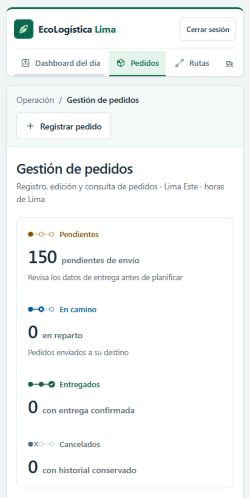

# Informe de reducción del impacto ambiental y optimización del sistema

**Nombre del Proyecto:** EcoLogística Lima – Optimizador de Rutas Sostenibles para DistriRápido S.A.C.

**Líder del Proyecto:** Ore Campos, Josef Pablo

**Sprint:** Sprint 4.

**Versión del documento:** V_1_1_0

**Autoría:** elaboración e implementación asistidas por Codex a solicitud del usuario; revisión del equipo pendiente.

**Fecha y hora de actualización:** 12/11/2026, 22:13:21, America/Lima (UTC−05:00). Cada ejecución conserva sus propias horas en las evidencias.

**Rama:** `refactor/mern`.

**Commit anterior:** `3b5bdae3930856101e8f8d7955813bc9ddaa9619`.

**Commit de implementación:** `9f953d6acc79d569d3896ab1e2a161d8321b3720`. Commit local; sin publicación ni fusión.

**Estado:** comparación medida y estimación digital completadas para los escenarios controlados definidos a continuación.

## 1. Propósito y cambios

Se optimizaron transferencia, carga y consultas conservando la funcionalidad y la autorización. El commit anterior es 3b5bdae y la implementación posterior es 9f953d6. Se aplican las ocho áreas de la [matriz técnica](04%20Est%C3%A1ndares%20arquitectura%20y%20gu%C3%ADa%20de%20desarrollo%20verde%20V_1_1_0.md).

Antes, App importaba estáticamente las vistas, el HTML solicitaba fuentes remotas, la API carecía de compresión y ETag, y los adaptadores operativos seleccionaban columnas innecesarias. Después, las vistas se difieren, se utilizan fuentes del sistema, la API comprime y revalida de forma privada, se proyectan columnas y se reutilizan lecturas dentro de cada resumen. Los listados indicados en la revisión incorporan páginas SQL y controles UI.

## 2. Método, entorno y comparabilidad

| Elemento | Configuración efectiva |
|---|---|
| Código anterior | Backend exportado con git archive de 3b5bdae; build frontend generado antes de editarlo. |
| Código posterior | Archivos de producción que se incorporaron a 9f953d6; no hubo cambios frontend de producto posteriores a sus mediciones. |
| Herramienta y navegador | Lighthouse 13.6.0; Edge/Chromium 157.0.0.0, sin ventana, emulación móvil y throttling simulado de Lighthouse. |
| Repeticiones | Tres por página y estado; se informa la mediana de cada métrica, no la mejor corrida. |
| Páginas | Acceso y Pedidos autenticado. Se verifica la carga de datos; no se mide solo una pantalla de error. |
| Datos y servicios | 150 pedidos sintéticos; API FastAPI real por HTTP en 127.0.0.1:5189 y repositorio en memoria. La sesión de prueba se inyecta únicamente en el ejecutor aislado. |
| Configuración común | Build de producción; reinicio del almacenamiento del navegador por Lighthouse; fuentes externas bloqueadas en ambos estados; dominios ajenos inyectados por software local bloqueados en ambos. |
| Base de datos separada | PostgreSQL 18.3/PostGIS, green_it_test, 1050 pedidos; lectura de planes y prueba de reutilización de consultas. |
| Fechas/horas | UTC original en before-summary.json y after-summary.json; conversión de usuario America/Lima UTC−05:00. Antes/después se midieron el 12/11/2026. Los demás comandos incluyen sus horas locales en sus recibos. |

Los [ejecutores](evidencias/optimizacion-3b5bdae/README.md) y los doce JSON/HTML conservan la configuración, el navegador exacto, las capturas y las solicitudes de cada corrida. La política de bloqueo hace el ensayo reproducible, pero los valores no representan el tráfico de un despliegue externo ni de usuarios reales.

## 3. Resultados antes y después

### 3.1 Pedidos autenticado: mediana de tres ejecuciones

| Métrica | Antes | Después | Diferencia o interpretación |
|---|---|---|---|
| Rendimiento Lighthouse | 85 / 100 | 99 / 100 | +14 puntos. |
| Accesibilidad Lighthouse | 100 / 100 | 100 / 100 | Sin variación; no es certificación WCAG completa. |
| FCP | 1658,47 ms | 1234,97 ms | Menor tiempo de primer contenido. |
| LCP | 4280,00 ms | 1981,68 ms | Menor tiempo de contenido principal. |
| TBT | 0 ms | 0 ms | Sin variación; no se divide por una base cero. |
| CLS | 0,0319047 | 0,0319047 | Sin variación. |
| Transferencia total de Lighthouse | 540336 bytes | 119920 bytes | Reducción del 77,8064 %. |
| Solicitudes registradas | 12 | 13 | Aumenta una por modularización; disminuyen los bytes. |
| CO₂e digital estimado por visita | 0,0800778 g | 0,0177721 g | Estimación del modelo, no medición eléctrica. |

### 3.2 Acceso: mediana de tres ejecuciones

| Métrica | Antes | Después |
|---|---|---|
| Rendimiento Lighthouse | 98 / 100 | 99 / 100 |
| FCP y LCP | 1661,97 ms | 1237,51 ms |
| Transferencia | 484043 bytes | 107355 bytes |
| Solicitudes registradas | 8 | 7 |
| Reducción de transferencia | Base | 77,8212 % |
| CO₂e digital estimado por visita | 0,0717352 g | 0,0159100 g |

El resultado agregado y sus valores sin redondear están en [comparacion.json](evidencias/optimizacion-3b5bdae/comparacion.json). La comparación considera toda la navegación observada; no suma todos los archivos de dist como si se transfirieran en cada visita.

### 3.3 API y PostgreSQL

| Comprobación | Antes / sin optimización | Después / con optimización | Alcance |
|---|---|---|---|
| Cuerpo HTTP de 100 pedidos, Accept-Encoding gzip | 36430 bytes | 1232 bytes | HTTP real, 150 pedidos ficticios en memoria; reducción del 96,6182 %. |
| Revalidación con If-None-Match | HTTP 200 y 36430 bytes | HTTP 304 y 0 bytes de cuerpo | Autorización ejecutada antes de validar ETag. |
| Latencia API | Muestras, media, mediana y P95 en api-before.json | Mismas medidas en api-after.json | Cinco calentamientos y treinta muestras por codificación; variación local, sin afirmar mejora estadística de latencia. |
| Consultas por resumen | 5 sin reutilización | 2 con reutilización por petición | Misma clase y datos; sin compartir caché entre peticiones. |
| Plan SQL | Consulta amplia sin el nuevo índice | Proyección y nuevo índice operativo | EXPLAIN ANALYZE y buffers reales en postgres-planes.json; una ejecución por plan, no un benchmark estadístico. |

Los [JSON de API](evidencias/optimizacion-3b5bdae/api-after.json) conservan los tiempos exactos y las cabeceras, sin mezclar latencia de un repositorio en memoria con tiempo PostgreSQL. La comprobación del índice lo retira solo dentro de una transacción en la base aislada y la revierte; no modifica índices del usuario.

## 4. Estimación ambiental y proyección

Se consultó el modelo primario [Sustainable Web Design Model v4](https://sustainablewebdesign.org/estimating-digital-emissions/) el 12/11/2026. Para primera visita se aplican 0,300 kWh/GB y 494 g CO₂e/kWh, con GB decimal (10⁹ bytes), visitante nuevo 1, recurrente 0 y factor de hosting verde 0. Es una estimación atribuida que incluye los segmentos operativos e incorporados del modelo; no mide consumo eléctrico ni emisiones de vehículos.

```text
Energía estimada por visita = bytes transferidos / 1 000 000 000 × 0,300
Emisiones estimadas por visita = energía estimada × 494
Proyección = diferencia de emisiones por visita × visitas anuales del escenario
```

| Página | Energía antes (kWh/visita) | Energía después (kWh/visita) | Ahorro del escenario anual (kg CO₂e) |
|---|---|---|---|
| Acceso | 0,0001452129 | 0,0000322065 | 0,5582516 |
| Pedidos | 0,0001621008 | 0,0000359760 | 0,6230565 |

La proyección supone 10000 visitas anuales a cada página: ejemplo parametrizado de 20 personas × 2 visitas × 250 días. Es un supuesto ilustrativo, no una cifra de usuarios o demanda observada. No se suman ambos ahorros como ahorro real de la empresa sin conocer las visitas de cada pantalla. El modelo y las fórmulas quedan codificados en [comparar_resultados.py](evidencias/optimizacion-3b5bdae/comparar_resultados.py); el efecto estimado no se presenta como reducción física verificada.

## 5. Evidencias visuales

Capturas originales extraídas de la primera corrida válida de Pedidos, sin modificar la imagen:




Los reportes representativos [antes](evidencias/optimizacion-3b5bdae/before-pedidos-1.html) y [después](evidencias/optimizacion-3b5bdae/after-pedidos-1.html), junto con las otras dos repeticiones, están enumerados en el [índice completo](evidencias/optimizacion-3b5bdae/README.md).

## 6. Conclusiones y referencias

Los ensayos controlados muestran menor transferencia y mejor LCP; las pruebas funcionales, coberturas y auditorías finales satisfacen los controles técnicos registrados. Se conserva el aumento de una solicitud en Pedidos y el alcance sintético del ensayo, sin seleccionar únicamente resultados favorables.

Fuentes: código de 3b5bdae y 9f953d6; recibos de ejecución; [modelo SWDM v4](https://sustainablewebdesign.org/estimating-digital-emissions/); [documentación de Gzip de Starlette](https://starlette.dev/middleware/#gzipmiddleware). La repetición en el despliegue real y la aceptación del evaluador no se sustituyen por estos resultados locales.

## Control de versiones del documento

| Versión | Fecha | Autoría / cambio |
|---|---|---|
| V_1_0_0 | 12/11/2026 | Elaboración asistida por Codex. Diagnóstico del corte `7ea33a1`, conservado en el commit `3b5bdae` y sus evidencias iniciales. |
| V_1_1_0 | 12/11/2026 | Elaboración asistida por Codex. Implementación `9f953d6`, validaciones actuales, medición antes/después y cierre técnico de las ocho áreas documentadas. |

[← Volver al índice correspondiente](README.md)
